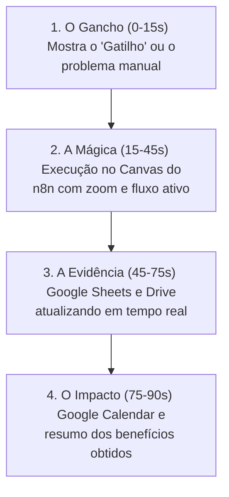

# Como Gravar Workflows n8n em Ação — Guia Completo e Referências

Este documento detalha o resultado da pesquisa prolongada sobre como capturar, de forma profissional, segura e esteticamente premium, o funcionamento de automações n8n integrando o ecossistema Google Workspace (Calendar, Sheets, Drive) e o próprio Canvas do n8n.

---

## 1. Estrutura Narrativa: O Roteiro de Ouro (Showcase de Automação)

Recrutadores, gestores e clientes não querem apenas ver uma tela piscando por 3 minutos. Eles buscam entender o **problema**, a **lógica** e o **resultado**. A estrutura ideal para um portfólio premium tem entre **60 e 90 segundos**:

### Detalhamento da Sequência:
1. **O Gatilho (Input):** Mostre o ponto de partida (ex: arrastar um PDF fictício de apólice/contrato para uma pasta no Google Drive).
2. **A Execução (n8n):** Transicione para o canvas do n8n mostrando o nó de gatilho recebendo o evento, seguido pelo fluxo brilhando em verde conforme executa (nós de processamento, IA e integração).
3. **A Ação Multi-App (Outputs):** Mostre as consequências imediatas:
   - O arquivo PDF sendo movido ou renomeado no Google Drive.
   - Uma nova linha aparecendo no Google Sheets com os dados limpos e estruturados.
   - Um evento de calendário sendo agendado no Google Calendar com o lembrete da tarefa.

---

## 2. Métodos de Composição Visual (Layout)

Como sua automação envolve quatro ambientes diferentes (Google Calendar, Sheets, Drive e n8n Canvas), o maior desafio é a disposição das telas. Aqui estão as três melhores abordagens identificadas na pesquisa:

### Método A: O Layout Dividido Lateral (Side-by-Side) — *Altamente Recomendado*
Você divide sua tela em duas janelas de proporção equilibrada (ou 60/40):
*   **Lado Esquerdo (60%):** O Canvas do n8n, pronto para rodar o fluxo e exibir a bolha de execução verde.
*   **Lado Direito (40%):** O Google Sheets (no topo) e o Google Drive/Calendar (na base), mostrando os resultados de forma síncrona.
*   **Como Fazer:** Use o recurso de Snap de Janelas do Windows (Win + Setas) ou do macOS para fixá-las lado a lado antes de iniciar a gravação.

### Método B: Transições e Foco Dinâmico (Zoom-and-Pan)
Em vez de mostrar tudo ao mesmo tempo, você grava a tela cheia e usa transições com aproximação suave focando exatamente onde a ação está acontecendo.
*   **Fluxo:** Zoom no Drive (drop do arquivo) $\rightarrow$ Transição rápida para o n8n (execução brilhando) $\rightarrow$ Zoom no Sheets (dados caindo) $\rightarrow$ Transição para o Calendar (evento aparecendo).
*   **Como Fazer:** Ferramentas automáticas como **Screen Studio** fazem isso de forma inteligente e automática seguindo o cursor do mouse e a atividade na tela.

### Método C: Picture-in-Picture (PiP)
Uma janela principal grande mostrando o n8n Canvas com uma janela menor flutuante no canto mostrando o Google Sheets/Drive atualizando em tempo real.
*   **Como Fazer:** Pode ser montado facilmente usando o OBS Studio ou em editores de vídeo como CapCut ou DaVinci Resolve após a gravação.

---

## 3. Ferramentas Recomendadas (Gravação e Edição)

| Ferramenta | Plataforma | Tipo | Propósito no Portfólio |
| :--- | :--- | :--- | :--- |
| **Screen Studio** | macOS | Gravação / Edição | **Premium:** Cria zooms e pans ultra suaves automaticamente seguindo o cursor. Remove tempos mortos e melhora a estética geral. |
| **OBS Studio** | Win / Mac / Linux | Gravação / Transmissão | **Flexibilidade:** Permite criar layouts complexos (múltiplas janelas capturadas individualmente), removendo abas do navegador e barras de endereço em tempo real. |
| **Tella.tv** | Web / SaaS | Gravação | **Layouts Prontos:** Excelente para gravar a webcam junto com o conteúdo e mudar de visual (lado a lado, tela cheia) instantaneamente. |
| **Loom / Screenity** | Chrome / SaaS | Gravação | **Rapidez:** Ideal se você quiser gravar um comentário em vídeo por cima do workflow para mandar a um cliente ou recrutador. |
| **CapCut / Descript** | Win / Mac / Web | Edição | **Pós-produção:** Ideal para cortar momentos de espera (ex: delay da API do Google), adicionar áudios sintéticos (ElevenLabs) e legendas dinâmicas. |

---

## 4. Segurança da Informação e LGPD (Guardrails Críticos)

Como o portfólio será público, expor dados reais é um risco grave de segurança. Siga estas técnicas para proteger suas informações:

### A. Extensões de Navegador para Mascarar Dados em Tempo Real
Para não precisar fazer edições manuais cansativas depois de gravar, use estas ferramentas no Chrome antes de iniciar o record:
1. **ZeroBlur:** Permite selecionar elementos HTML inteiros ou áreas específicas da tela e aplicar um blur persistente (mesmo que a página recarregue).
2. **Obscuro (ou extensions similares):** Não apenas borra, mas substitui dados privados por dados fictícios realistas (Scramble Mode), mantendo o visual profissional sem blocos borrados.
3. **DataBlur / Blur It:** Boas opções para ocultar e-mails, telefones ou menus de navegação do Google Workspace.

### B. Técnicas Manuais de Proteção
*   **Google Workspace Dedicado a Testes:** Crie uma conta Google alternativa (gratuita) com o nome "Matheus Testes" ou "Matheus Automações". Nunca use seu e-mail pessoal nas gravações.
*   **Ajuste do Navegador:** Grave em uma janela anônima ou em um perfil limpo do navegador (sem histórico, sem favoritos e sem extensões pessoais visíveis).
*   **Ocultar URLs e IDs:** Reduza a janela do navegador levemente ou configure a ferramenta de captura de tela para capturar **apenas a área do conteúdo da página**, ocultando a barra de endereços (que expõe IDs sensíveis de pastas do Google Drive e planilhas).
*   **Limpeza do Canvas do n8n:** Certifique-se de que nenhum nó de credenciais exiba chaves de API, senhas ou tokens em modo texto claro durante a gravação.

---

## 5. Dicas de Estética Premium para o Portfólio

Para que o site cause um impacto visual premium de alto padrão, implemente as seguintes diretrizes:

*   **Velocidade Acelerada:** Workflows que envolvem APIs do Google costumam ter delays de 2 a 10 segundos. Na edição, **acelere os momentos de carregamento**. O fluxo deve parecer ágil e responsivo.
*   **Contraste e Cores:** Use o n8n em Modo Escuro (Dark Mode). O contraste das linhas de conexão do canvas com o brilho verde de execução fica muito mais destacado e moderno.
*   **Qualidade da Captura:** Grave em uma resolução mínima de 1080p. Se o monitor for 4K, ajuste a escala do sistema para 125% ou 150% antes de gravar para que os textos (do Sheets e dos nós do n8n) fiquem legíveis em telas menores de celulares.
*   **Mouse Grande e Destacado:** Habilite o destaque do cursor do mouse (disponível no Screen Studio ou através de utilitários no Windows, como o PowerToys). Isso ajuda o visualizador a acompanhar seu raciocínio visualmente.
